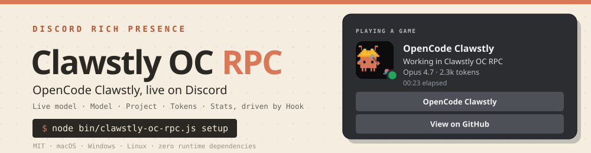
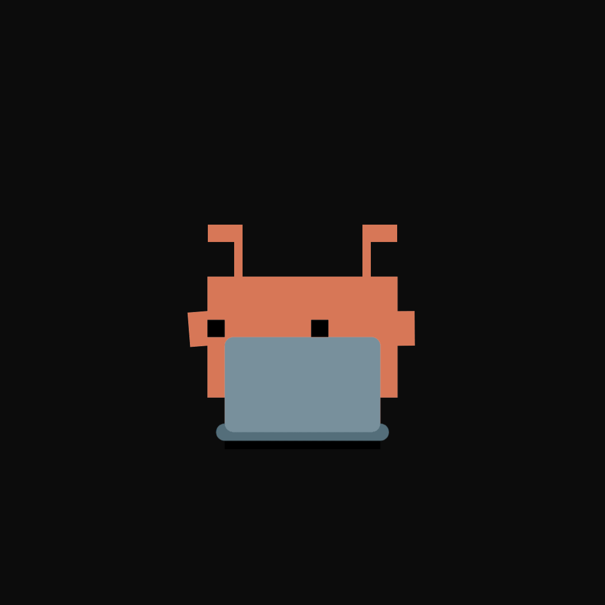
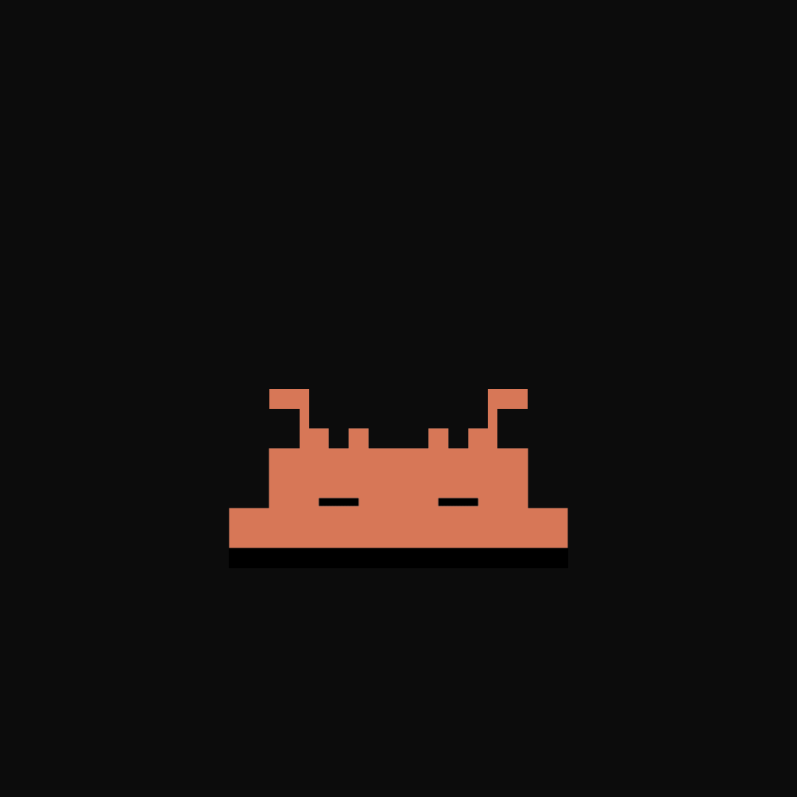

<div align="center">



<br />






<sub>Card's live states - <b>Working</b> · <b>Thinking</b> · <b>Notification</b> · <b>Idle</b></sub>

Discord Rich Presence for [**OpenCode Clawstly**](https://github.com/sdkitagawa/clawstly_oc_buddy).

</div>

---

<br />

# Clawstly OC RPC

Clawstly Discord Rich Presence for **OpenCode** into an OpenCode V2 plugin with a local daemon.

## Requirements

- Node.js 18+
- OpenCode V2
- Discord desktop client running and signed in (Rich Presence uses local Discord IPC)
- Your own Discord application Client ID

## Install

```bash
node bin/clawstly-oc-rpc.js setup
```

`setup` will:

- create `config.json` from the shipped defaults if it does not exist
- register this project's `plugin/` directory in your OpenCode V2 config
- print the Discord Portal steps and current status

To see the config snippet without writing anything:

```bash
node bin/clawstly-oc-rpc.js setup --print-plugin
```

OpenCode config locations checked by setup:

- `~/.config/opencode/opencode.jsonc` (also on Windows)
- `./opencode.jsonc`
- `./.opencode/opencode.jsonc`

The plugin registration looks like:

```jsonc
{
  "$schema": "https://opencode.ai/config.json",
  "plugins": [
    "C:/absolute/path/to/clawstly_oc_rpc/plugin"
  ]
}
```

OpenCode reloads config changes automatically; check with `opencode plugin list` if needed. Restart the daemon after changing `config.json`:

```bash
node bin/clawstly-oc-rpc.js restart
```

## Easy launcher

Four launchers are included so you never have to type a command:

| File | Platform | How to run |
| --- | --- | --- |
| `run.cmd` | Windows | Double-click, or `run.cmd <action>` |
| `run.bat` | Windows | Double-click, or `run.bat <action>` |
| `run.ps1` | Windows | `powershell -File run.ps1 <action>` |
| `run.sh` | Git Bash / WSL / macOS / Linux | `./run.sh <action>` |

`run.cmd` and `run.bat` are thin wrappers around `run.ps1`, so all three Windows
launchers share the same behavior. Requirements: Node 18+ on `PATH`, and the
project folder in place. No build step is needed.

All four launchers follow the **currently selected plugin source** (see option
5 below). It does not matter which copy's launcher you double-click: every
launcher resolves the active registration and then runs that copy's CLI and
reads that copy's `config.json`. So the model you last selected is the same no
matter which launcher you use.

With no arguments they open this menu (identical in all four launchers):

```text
 1 -  Start all - Daemon / Dashboard Server.
 2 -  Stop all - Disable Plug-In, Stop Daemon/Dashboard, Force-stop leftovers.
 3 -  Restart all.
 4 -  Restart RPC only.
 5 -  Plugin source.
 6 -  Open dashboard.
 7 -  Status.
 8 -  Health check.
 9 -  Change displayed model.
10 -  Token / Cost display.
11 -  Start RPC only (Daemon).
12 -  Stop RPC only (Daemon).
13 -  Start Dashboard -> Browser.
14 -  Exit.
```

What the start/stop options actually control:

- **Daemon** = the `node … src/daemon.js` process that pushes Discord Rich Presence.
- **Dashboard / Node server** = the `node … clawstly-oc-rpc.js serve` process on
  `http://127.0.0.1:47474`. The browser page and Node server are the same thing;
  there is no third component.
- **1 Start all** starts the daemon **and** the dashboard server. It does **not**
  open a browser - use option 13 for that.
- **2 Stop all** writes the no-respawn marker first, which also makes the
  OpenCode plug-in inert without stopping OpenCode. It then clean-stops the
  daemon, stops the dashboard server, force-stops any leftover Node process whose
  command line still runs our daemon or server script, and verifies that nothing
  is left. Other Node processes and OpenCode itself are never touched.
- **3 Restart all** = stop all, then start all.
- **4 Restart RPC only** restarts just the daemon.
- **6 Open dashboard** ensures the server is up, then opens the browser.
- **11 / 12** start or stop only the daemon (headless Discord presence).
- **13 Start Dashboard → Browser** starts the server and opens the dashboard.

Direct arguments skip the menu. All launchers accept:

```bash
run.cmd start-all          # daemon + dashboard server, no browser
run.cmd stop-all           # plug-in disabled, daemon + server stopped, leftover sweep
run.cmd restart-all
run.cmd restart-rpc        # daemon only
run.cmd start              # daemon only
run.cmd stop               # daemon only
run.cmd source status      # show the active registration
run.cmd source C           # use the local C: source plugin
run.cmd source D           # use the D: mirror plugin
run.cmd source "<abs path>"# use any absolute plugin directory
run.cmd dashboard          # start server + open browser
run.cmd dashboard-start    # server only, no browser
run.cmd dashboard-stop
run.cmd status
run.cmd doctor
run.cmd model sol          # or luna | astra | opus | sonnet | haiku | fable | real
run.cmd metric cost        # or tokens | both
```

`./run.sh` accepts the same arguments and is fully independent of PowerShell:
it uses the POSIX script path and `curl`/`wget` / `xdg-open`, and only touches
`cygpath`, `netstat` or `cmd.exe` when running under Git Bash/MSYS on Windows.
On macOS/Linux the source shortcuts are `L` (this install's own `plugin/`
directory) and `M` (an optional mirror); `C`/`D` remain accepted aliases.
Override the presets with `CLAWSTLY_PLUGIN_SOURCE` / `CLAWSTLY_PLUGIN_MIRROR`.

## Plugin registration / source selection

OpenCode V2 loads plugins from its own `opencode.json(c)` - not from a command
hook. The plugin is a directory entry, and it must appear **exactly once**;
registering both copies produces `Duplicate plugin ID: clawstly-oc-rpc` in
`/plugins`.

OpenCode looks for the user config in these locations. The launcher checks each
one (and project-local configs) and edits the file that currently registers the
plugin, or the global user config if none does:

| Platform | Global user config | System-managed (read-only) |
| --- | --- | --- |
| Windows | `%USERPROFILE%\.config\opencode\opencode.jsonc` | `%ProgramData%\opencode\` |
| macOS | `~/.config/opencode/opencode.jsonc` | `/Library/Application Support/opencode/` |
| Linux | `~/.config/opencode/opencode.jsonc` (or `$XDG_CONFIG_HOME/opencode/`) | `/etc/opencode/` |

Full resolution order: `OPENCODE_CONFIG` → `$XDG_CONFIG_HOME/opencode` →
`~/.config/opencode` → `%APPDATA%\opencode` (Windows fallback) → project-local
`opencode.json(c)` / `.opencode/opencode.json(c)`. System directories are
detected but never rewritten. Only the `plugins` array is replaced, so comments
and every other setting survive. Paths use the host OS's separators.

Use **menu option 5** or the CLI:

```bash
node bin/clawstly-oc-rpc.js source status          # active source + config path
node bin/clawstly-oc-rpc.js source C               # local source copy (Windows)
node bin/clawstly-oc-rpc.js source D               # D: git mirror (Windows)
node bin/clawstly-oc-rpc.js source L               # local source copy (macOS/Linux)
node bin/clawstly-oc-rpc.js source M               # mirror (macOS/Linux)
node bin/clawstly-oc-rpc.js source /opt/clawstly/plugin  # custom absolute path
```

Switching the source clean-stops the current daemon so the newly loaded plugin
copy spawns its own. **Restart OpenCode after switching** so it reloads the
config; the existing OpenCode process keeps running until then.

Only **one** registration should exist. Both copies declare the same plugin ID
(`clawstly-oc-rpc`), so two entries - even two entries in different config files
- make OpenCode show `clawstly-oc-rpc failed, local` in `/plugins`. Choosing a
source removes every Clawstly entry from all writable configs and writes exactly
one to the active config. `source status` and `doctor` both flag duplicate or
stale object-format registrations if they reappear.

## Commands

```bash
node bin/clawstly-oc-rpc.js setup [--yes] [--print-plugin]
node bin/clawstly-oc-rpc.js source [status|C|D|<absolute path>]
node bin/clawstly-oc-rpc.js start-all
node bin/clawstly-oc-rpc.js stop-all
node bin/clawstly-oc-rpc.js restart-all
node bin/clawstly-oc-rpc.js start
node bin/clawstly-oc-rpc.js stop
node bin/clawstly-oc-rpc.js restart
node bin/clawstly-oc-rpc.js daemon-start | daemon-stop | daemon-restart
node bin/clawstly-oc-rpc.js dashboard-start | dashboard-stop | dashboard-status
node bin/clawstly-oc-rpc.js processes
node bin/clawstly-oc-rpc.js status
node bin/clawstly-oc-rpc.js doctor
node bin/clawstly-oc-rpc.js serve [--port 47474]
node bin/clawstly-oc-rpc.js scan
node bin/clawstly-oc-rpc.js config get [key]
node bin/clawstly-oc-rpc.js config set <key> <json-value>
node bin/clawstly-oc-rpc.js model [alias|custom label]
node bin/clawstly-oc-rpc.js metric <tokens|cost|both>
node bin/clawstly-oc-rpc.js private add <cwd>
node bin/clawstly-oc-rpc.js private remove <cwd>
node bin/clawstly-oc-rpc.js private list
node bin/clawstly-oc-rpc.js pause <duration|off>
node bin/clawstly-oc-rpc.js help [command]
```

`hook` is intentionally absent. OpenCode uses the V2 plugin in `plugin/index.ts` instead.

## Privacy display controls

The Discord card shows **Clawstly** as its app name. Two config keys control what else is visible:

- `displayModel` - the model name Discord sees. Defaults to `Claude Opus`. Choices: `GPT Sol`, `GPT Luna`, `GPT Astra`, `Claude Opus`, `Claude Sonnet`, `Claude Haiku`, `Claude Fable`, a custom label, or blank to use the real model. This never changes the model OpenCode actually runs.
- `displayMetric` - `tokens`, `cost`, or `both`. Defaults to `cost`, rendered with `≈` because it is an estimate from local pricing data, not a bill.

Use launcher menu options **9** (Change displayed model) and **10** (Token / Cost display), the `/settings` page, or the `model` and `metric` commands above. Changes restart the daemon so the card updates immediately.

The dashboard keeps a timestamped record of the displayed model. Each session row shows the label that was active when that session was last active, so switching models does **not** relabel older rows; only new activity uses the new label. Selecting `real` is recorded too, and those rows fall back to the actual OpenCode model. The header badge and Discord card always show the current label.

## Local dashboard

```bash
node bin/clawstly-oc-rpc.js serve
```

Then open <http://127.0.0.1:47474>. The dashboard shows live OpenCode sessions, the current presence preview, aggregate stats, charts, and a `/settings` page for templates, asset keys or GIF URLs, model/metric display, privacy, and daemon controls. The server binds to loopback only and enforces same-origin checks on POST routes.

## Discord Developer Portal setup

1. Open the [Discord Developer Portal](https://discord.com/developers/applications) and create an application.
2. Copy the **Application ID** (this is the OAuth2 Client ID used for Rich Presence).
3. Choose card art:
   - **Static Discord art:** under **Rich Presence → Art Assets**, upload images and use their asset names. The defaults are `oc_working`, `oc_thinking`, `oc_compacting`, `oc_shipped`, `oc_idle`, and `oc_notification`.
   - **Animated GIFs (upstream style):** host your own GIFs at public direct URLs - GitHub raw or GitHub Pages works - and set those URLs as `statusAssets` values in `config.json`. Discord fetches the GIF directly; the daemon does not download or proxy it. Use a direct file URL, not a GitHub blob page, and do not reuse upstream `clawd-*` assets.

   Example:

   ```json
   {
     "clientId": "1572562385951002674",
     "statusAssets": {
       "working": "https://raw.githubusercontent.com/sdkitagawa/clawstly_oc_rpc/main/assets/status/clawstly_oc_working.gif",
       "thinking": "https://raw.githubusercontent.com/sdkitagawa/clawstly_oc_rpc/main/assets/status/clawstly_oc_thinking.gif",
       "compacting": "https://raw.githubusercontent.com/sdkitagawa/clawstly_oc_rpc/main/assets/status/clawstly_oc_compacting.gif",
       "shipped": "https://raw.githubusercontent.com/sdkitagawa/clawstly_oc_rpc/main/assets/status/clawstly_oc_shipped.gif",
       "idle": "https://raw.githubusercontent.com/sdkitagawa/clawstly_oc_rpc/main/assets/status/clawstly_oc_idle.gif",
       "notification": "https://raw.githubusercontent.com/sdkitagawa/clawstly_oc_rpc/main/assets/status/clawstly_oc_notification.gif"
     }
   }
   ```
4. Put the Application ID in `config.json` as `clientId`, or edit it later in the local dashboard at `http://127.0.0.1:47474/settings`.

> The default value `YOUR_DISCORD_CLIENT_ID` is a placeholder. Presence will not appear in Discord until you replace it with your own application ID.

## What the plugin maps

The V2 plugin writes one state file per OpenCode session and maps:

- `session.created` → Session seed
- `session.hook("prompt")` → Early thinking status
- `session.inbox.delivered` → Prompt count, thinking status
- `ctx.tool.hook("execute.before"/"execute.after")` → Working status, tool/file counters, ship detection
- `ctx.shell.hook("create.before")` → Shell command activity
- permission and form hooks/events → Notification status
- `session.hook("compaction")`, Compaction events → compacting status
- `session.usage.updated` → Token and cost counters
- `session.idle`, Execution end, shutdown → idle/closed state

See [`plugin/README.md`](plugin/README.md) for details.

## Files and data

| Purpose | Location |
| --- | --- |
| User config | Rename the `config.example.json` to `config.json` in this folder, then configure the settings manually or by using one of the [launchers](#easy-launcher) |
| Live session state | OS temp dir: `clawstly-oc-rpc/state-<sessionId>.json` |
| Aggregate stats | `~/.clawstly-oc-rpc/aggregate.json` |
| Daemon log | OS temp dir: `clawstly-oc-rpc/daemon.log` |
| Dashboard | `http://127.0.0.1:47474` |

## License

Upstream MIT notice retained in [`LICENSE`](LICENSE).
